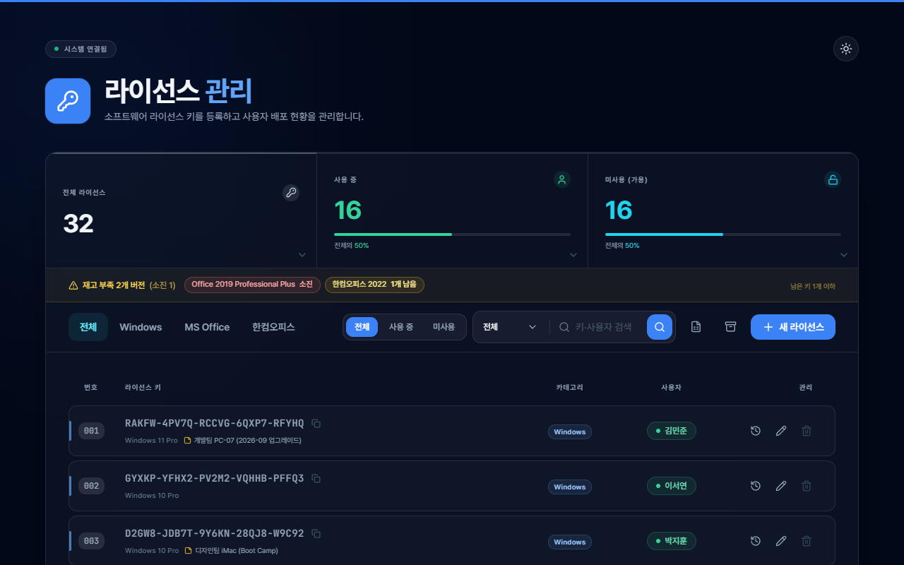
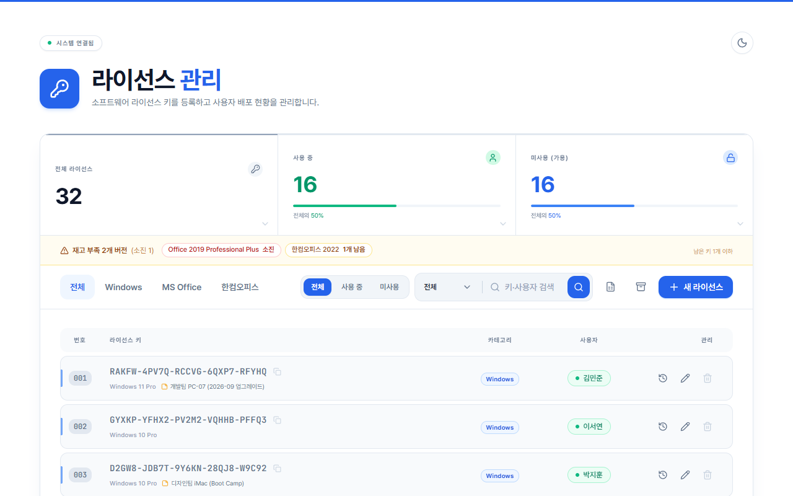
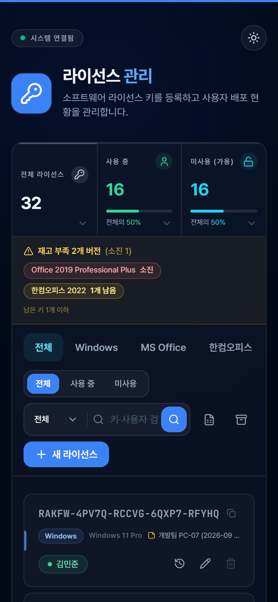
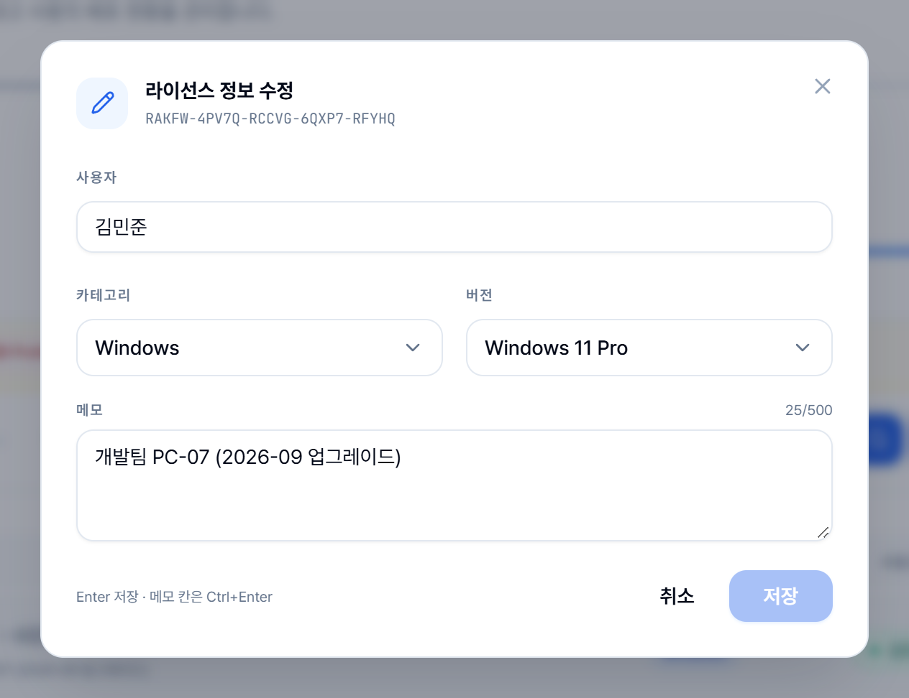
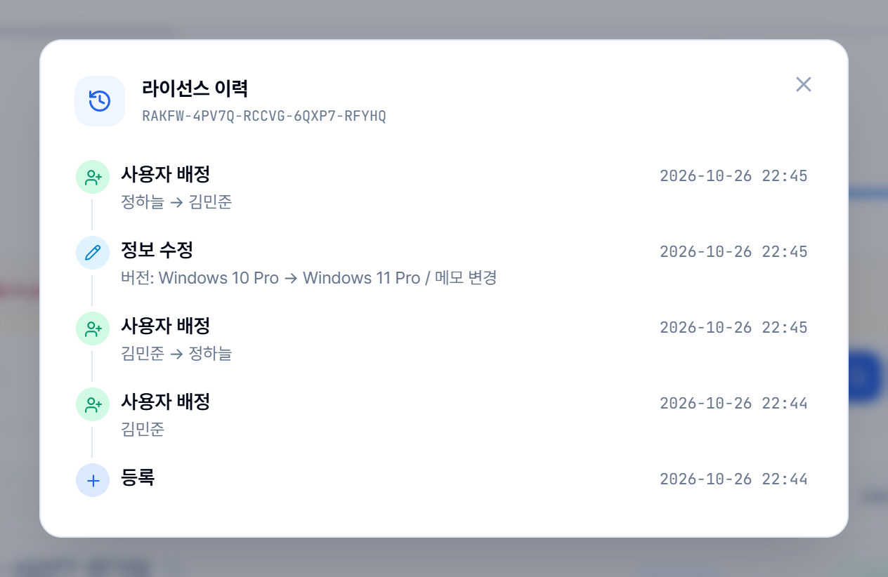
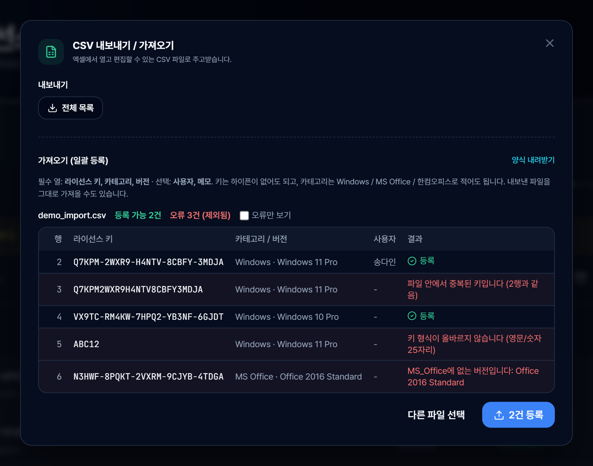
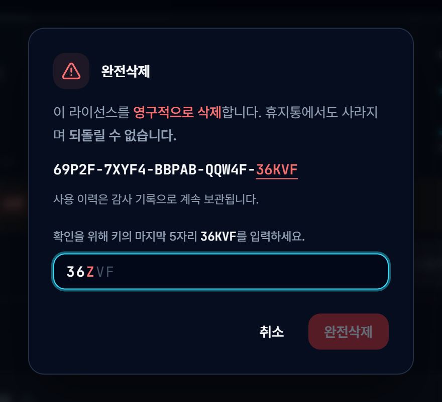
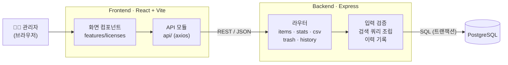
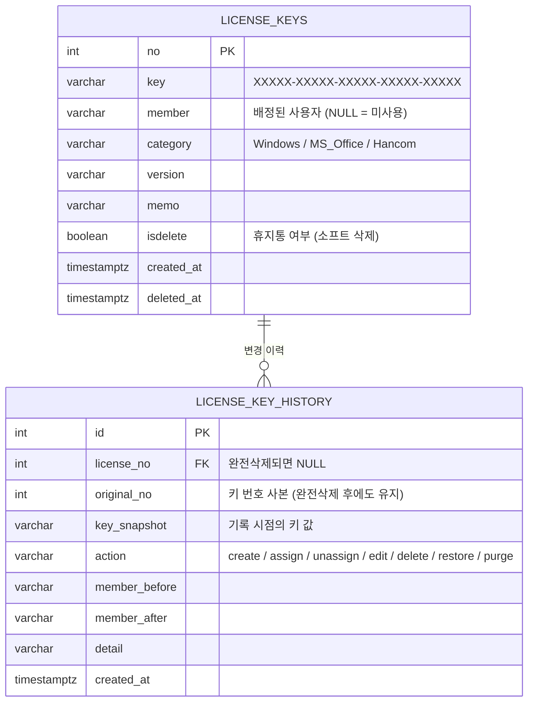

<div align="center">

# 🔑 Key Manager

**Windows · MS Office · 한컴오피스 라이선스 키를 등록하고,<br/>누가 어떤 키를 쓰고 있는지 웹에서 관리하는 사내 도구**




</div>

<br/>

## 왜 만들었나요

라이선스 키를 엑셀로 관리하면 **같은 키를 두 명에게 배정**하거나, **남은 키가 몇 개인지** 바로 알기 어렵고,
**누가 언제 썼는지** 기록이 남지 않습니다.
Key Manager는 키 등록 → 사용자 배정 → 현황 확인을 한 화면에서 처리하고, 모든 변경을 이력으로 남깁니다.

## 주요 기능

| | 기능 | 설명 |
|---|---|---|
| 📥 | **등록** | 25자리 키를 5칸으로 나눠 입력 (전체 키 붙여넣기 지원) · CSV 일괄 등록(미리보기로 오류 행 확인 후 등록, 한국어 엑셀 CSV 지원) |
| 👥 | **배정·수정** | 사용자 배정/해제, 카테고리·버전 수정, 메모(PC명·부서·구매일 등) |
| 📊 | **현황** | 사용 중 / 미사용 통계, 남은 키가 적은 버전 **재고 부족 경고** |
| 🔍 | **검색** | 키·사용자·메모 검색 (키는 하이픈 없이 일부만 입력해도 검색), 카테고리·사용 상태 필터 |
| 🕘 | **이력** | 등록·배정·해제·수정·삭제·복구·완전삭제를 시각과 함께 기록 (감사 로그) |
| 🗑️ | **안전한 삭제** | 사용 중인 키는 삭제 불가 · 휴지통에서 복구 · 완전삭제는 키 마지막 5자리를 직접 입력해야 실행 |
| 📤 | **내보내기** | 현재 필터 그대로 CSV로 내보내기 (엑셀에서 바로 열림) |
| 🌗 | **화면** | 다크 / 라이트 모드, 데스크톱 · 태블릿 · 모바일 반응형 |

## 스크린샷

> 스크린샷은 데모용 가짜 데이터로 촬영했습니다.

<table>
  <tr>
    <td width="72%" align="center"><br/><sub>라이트 모드</sub></td>
    <td width="28%" align="center"><br/><sub>모바일</sub></td>
  </tr>
</table>

<table>
  <tr>
    <td width="50%" align="center"><br/><sub>정보 수정 — 사용자 · 버전 · 메모</sub></td>
    <td width="50%" align="center"><br/><sub>키별 이력 타임라인</sub></td>
  </tr>
  <tr>
    <td width="50%" align="center"><br/><sub>CSV 가져오기 — 등록 전 행별 검증 결과</sub></td>
    <td width="50%" align="center"><br/><sub>완전삭제 확인 — 틀린 글자는 빨간색으로 표시</sub></td>
  </tr>
</table>

## 아키텍처





**설계 포인트**

- **소프트 삭제 + 부분 유니크 인덱스** — 삭제는 휴지통으로 이동(`isdelete`)만 하고, 키 중복 검사는 휴지통에 없는 키끼리만 합니다. 지운 키는 같은 값으로 다시 등록할 수 있습니다.
- **변경과 이력을 한 트랜잭션으로** — 키 상태 변경과 이력 기록이 함께 커밋되거나 함께 롤백되어, 이력이 빠지는 일이 없습니다.
- **완전삭제해도 이력은 남음** — 이력이 키 값 사본(`key_snapshot`)을 갖고 있어, 키 행이 사라져도 감사 기록은 유지됩니다.
- **서버에서 한 번 더 검증** — 키 형식, 카테고리·버전 목록, 사용 중인 키 삭제 금지 등 화면의 규칙을 API에서도 똑같이 검사합니다.
- **자동 스키마 관리** — 서버가 시작할 때 테이블·인덱스를 만들고 필요한 마이그레이션을 적용합니다 (여러 번 실행해도 안전).

## 기술 스택

| 구분 | 사용 기술 |
|---|---|
| **Frontend** | React 18, TypeScript, Vite, Tailwind CSS 3, Radix UI (shadcn/ui 스타일), Axios, lucide-react, sonner |
| **Backend** | Node.js, Express 4, TypeScript, node-postgres (pg) |
| **Database** | PostgreSQL |
| **Test** | Jest + supertest (백엔드 단위·API 통합), Vitest + Testing Library (프론트엔드) |

## 시작하기

**필요한 것**: Node.js **20.19 이상**, PostgreSQL

```bash
# 1. 백엔드 — http://localhost:5000
cd backend
cp .env.example .env        # DB 접속 정보(DB_PASSWORD 등) 입력
npm install
npm run dev                 # 첫 실행 시 테이블이 자동으로 만들어집니다

# 2. 프론트엔드 — http://localhost:3000
cd frontend
npm install
npm run dev
```

백엔드 주소가 `http://localhost:5000`이 아니라면 `frontend/.env`에 `REACT_APP_API_URL`을 지정하세요.

## 테스트

```bash
cd backend
npm test                    # 단위 테스트
npm run test:integration    # API 통합 테스트 — 별도 테스트 DB(<DB_NAME>_test)를 자동으로 만들어 사용, 실제 데이터는 건드리지 않음

cd frontend
npm test                    # 단위 · 컴포넌트 테스트
```

## 프로젝트 구조

```
├── backend/                 Express API 서버
│   └── src/
│       ├── routes/          기능별 API (items · stats · csv · trash · history · meta)
│       ├── db.ts            커넥션 풀, 스키마 생성 · 마이그레이션
│       ├── errors.ts        공통 에러 응답 (JSON)
│       └── __integration__/ API 통합 테스트
├── frontend/                React 웹 화면
│   └── src/
│       ├── features/licenses/  목록 · 등록 · 수정 · 휴지통 · 이력 · CSV 화면
│       ├── components/ui/      공용 UI 컴포넌트
│       ├── api/                백엔드 호출
│       └── lib/                화면과 분리된 로직 (CSV 파싱, 키 입력, 재고 판단 등)
└── docs/images/             README 스크린샷
```

## 문서

| 문서 | 내용 |
|---|---|
| [backend/README.md](backend/README.md) | API 명세, DB 스키마, 직접 SQL을 쓸 때 주의점 |
| [frontend/README.md](frontend/README.md) | 화면 구성, 컴포넌트 설명, 개발 환경 |
| [project-overview.md](project-overview.md) | 개발 과정과 트러블슈팅 기록 |
